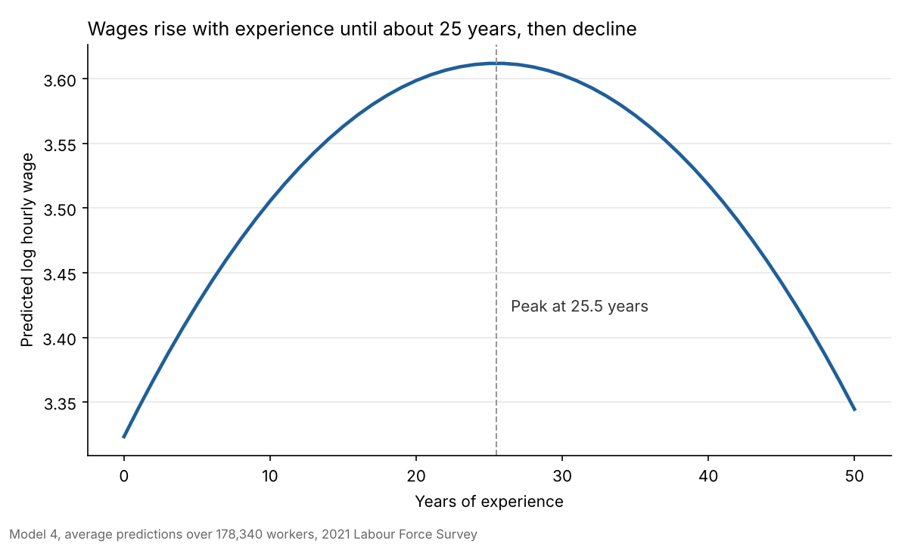

# Wage Determinants in Vietnam: Econometric Analysis

Regression analysis of what drives hourly wages for 178,340 Vietnamese workers in the 2021 Labour Force Survey: education, experience, gender, marital status, public vs private sector, urban vs rural location and region. Built in Stata for the Econometrics course (INS3049) at VNU International School.

## Key findings

- **Education pays about 5% per year:** each extra year of schooling raises hourly wages by about 5.1%, holding other factors constant.
- **The return to education is higher in cities:** about 5.5% per year in urban areas against 4.0% in rural areas (interaction significant, p < 0.001).
- **The gender gap is a private-sector gap:** men earn about 20% more than women in the private sector, but in the public sector the gap disappears (men earn about 1.6% less than women).
- **Wages peak after about 25 years of experience:** predicted wages rise by about 33% from career entry to the peak at 25.5 years, then decline.
- **Location matters:** compared with the Northern Midlands & Mountains, wages are about 30% higher in the Southeast and 11% higher in the Red River Delta, but 2.6% lower in the Central Highlands.

## Data

- **Source:** 2021 Vietnam Labour Force Survey (General Statistics Office), 178,340 wage earners
- **Outcome:** hourly wage in thousand VND, and `log_wage = ln(wage + 1)`
- **Explanatory variables:** years of schooling, potential experience, gender, marital status, public sector, urban, six regions

The survey microdata is not included in this repository.

## Method

1. **Model 1:** OLS of hourly wage on all explanatory variables. Age was dropped because it equals experience + education + 6.
2. **Diagnostics:** VIF for multicollinearity, Ramsey RESET for functional form, Breusch-Pagan for heteroskedasticity. Heteroskedasticity was detected, so all models use robust standard errors.
3. **Model 2:** log wage with a gender × public sector interaction.
4. **Model 3:** log wage with an education × urban interaction, plus an F-test on the interaction.
5. **Model 4:** log wage with a quadratic experience term; turning point at −β₁ / (2β₂) and predictive margins for the chart.

## Results

Robust standard errors; all coefficients shown are significant at the 1% level unless marked.

| Variable | Model 1 (wage) | Model 2 (log wage) | Model 3 (log wage) | Model 4 (log wage) |
|---|---|---|---|---|
| Education (years) | 2.226 | 0.049 | 0.040 | 0.050 |
| Male | 5.512 | 0.181 | 0.143 | 0.133 |
| Public sector | 1.974 | 0.104 | 0.007 (p = 0.10) | −0.005 (n.s.) |
| Male × public sector | | −0.197 | | |
| Education × urban | | | 0.015 | |
| Experience | 0.149 | 0.0006 | 0.0002 (p = 0.10) | 0.0227 |
| Experience² | | | | −0.0004 |
| R² | 0.117 | 0.217 | 0.215 | 0.229 |
| Observations | 178,340 | 178,340 | 178,340 | 178,340 |

All models also control for marital status, urban location and region.

## Files

| File | Contents |
|---|---|
| `project3.do` | Stata script: data preparation, four models, diagnostics, tests and chart |
| `report.pdf` | final group report |
| `experience_wage_profile.png` | predicted wage by years of experience (Model 4) |

## How to run

Place the survey extract as `project3.dta` in the same folder as `project3.do`, then run the script in Stata. It installs `outreg2` if needed and writes the regression table to `project3_results.doc`.

## Team

Group 7, INS3049: Mạc Hải Nam (interaction and quadratic tests, regression output, charts and Stata code), Lưu Văn Toàn, Tạ Quang Khôi, Vũ Ngọc Huyền, Nguyễn Diệu Huyền.
